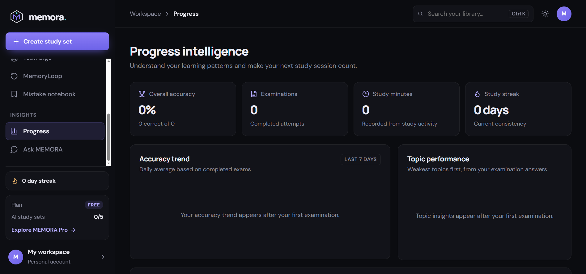

<div align="center">

# ◈ MEMORA

### Your knowledge. Your memory. Your mastery.

**An AI-powered learning, reviewer, and examination platform.**

A premium study workspace that transforms class notes, documents, and topic prompts into structured reviewers, flashcards, and practice examinations.

<br/>


</div>

---

## ✦ Overview

MEMORA is a student-focused learning platform built around one continuous workflow:

**Upload or prompt → Understand → Organize → Generate → Study → Test → Improve**

The application includes a working local-first study workspace, document text extraction, server-side Gemini integration, interactive flashcards, practice examinations, spaced repetition, mistake tracking, and activity-based learning insights.

## ✧ Screenshots

> Add your screenshots to `images/` and update the paths below.

<div align="center">

| Workspace | Reviewer |
|:---:|:---:|
|  |  |
| **Flashcard Studio** | **TestForge** |
|  |  |
| **MemoryLoop** | **Progress Intelligence** |
|  |  |

</div>

## ✦ Features

- **Document-to-study workflow** — Extract text from PDF, DOCX, PPTX, and TXT files, or paste notes and prompts.
- **Source-grounded AI generation** — Gemini generates reviewers, key terms, questions, and flashcards using supplied source material as the primary authority.
- **Smart Reviewer** — Read structured study notes, definitions, and key points.
- **Flashcard Studio** — Flip cards, navigate a deck, and rate recall.
- **TestForge** — Multiple-choice and short-answer practice, question navigation, flagging, submission, scoring, and explanations.
- **MemoryLoop** — SM-2-inspired scheduling based on recall ratings.
- **Mistake Notebook** — Automatically collects incorrect examination answers and converts them into flashcards.
- **Progress Intelligence** — Charts and summaries are derived from actual local activity; no sample analytics are presented as user data.
- **Ask MEMORA** — Ask questions with the selected study set as context.
- **Freemium-ready plan UI** — Free workspace and Pro preview; no simulated payment.
- **Responsive premium interface** — Dark/light appearance, motion, and reduced-motion support.

## ✦ Technology

| Layer | Tools |
|---|---|
| Frontend | React, TypeScript, Vite |
| Styling & motion | Custom CSS, Framer Motion |
| Icons | Lucide React |
| Charts | Recharts |
| Document parsing | PDF.js, Mammoth, JSZip |
| Backend | Express, Zod |
| AI | Google Gemini API (server-side) |
| Database foundation | Supabase / PostgreSQL SQL schema |
| Testing | Vitest |

## ✦ Architecture

```text
Browser (React + TypeScript)
  ├── Local workspace persistence (localStorage)
  ├── PDF / DOCX / PPTX / TXT extraction
  ├── Reviewer, flashcard and examination UI
  └── /api requests
          │
          ▼
Express API (server/index.ts)
  ├── Input validation (Zod)
  ├── Gemini API (server-only secret)
  └── Structured JSON generation
          │
          ▼
Supabase-ready PostgreSQL schema
  ├── User-owned documents and study sets
  ├── Flashcards and review schedules
  └── Exams, answers, mistakes and usage quotas
```

## ✦ Interface Architecture

All application state and logic stays in `src/App.tsx`. Everything visual is split into small, reusable modules:

```text
src/
├── App.tsx              # state, handlers, routing between pages
├── styles.css           # design tokens + component styles (dark / light)
├── components/          # ui primitives, Shell (sidebar, topbar, bottom nav), Modals, charts
├── pages/               # Dashboard, Library, Reviewer, Flashcards, TestForge,
│                        # MemoryLoop, Mistakes, Insights, Ask, Settings
└── lib/                 # motion variants, SM-2 scheduling (srs.ts), formatting, storage
```

**Motion:** one easing curve and shared variants live in `src/lib/motion.ts`. Every animation respects `prefers-reduced-motion` (`MotionConfig reducedMotion="user"` plus a CSS fallback).

**Keyboard shortcuts**

| Where | Keys |
|---|---|
| Anywhere | `Ctrl/Cmd + K` focuses search |
| Flashcards | `Space` flip · `←` `→` navigate · `1`–`4` rate after flipping |
| TestForge | `A`–`D` or `1`–`4` choose · `←` `→` navigate |
| Dialogs | `Esc` closes · `Tab` stays inside |

## ✦ Getting Started

### Requirements

- Node.js 20 or newer
- npm
- A Google Gemini API key for AI generation

### 1. Clone the repository

```bash
git clone https://github.com/your-username/memora.git
cd memora
```

### 2. Install dependencies

```bash
npm install
```

### 3. Configure environment

```bash
cp .env.example .env
```

Add your Gemini key to `.env`:

```env
GEMINI_API_KEY=your_gemini_api_key
GEMINI_MODEL=gemini-2.0-flash
PORT=8787
```

Never commit `.env`. The Gemini key is read by the Express server and is never included in frontend variables.

### 4. Start development servers

```bash
npm run dev
```

- Vite frontend: `http://localhost:5173`
- Express API: `http://localhost:8787`

If PowerShell blocks `npm.ps1`, use `npm.cmd install` and `npm.cmd run dev`.

### 5. Build for production

```bash
npm run build
npm test
```

## ✦ Supabase Setup

The current app runs in local demo mode and persists study data in the browser. To move to multi-device accounts:

1. Create a Supabase project.
2. Open the SQL Editor.
3. Run `database/schema.sql`.
4. Configure Supabase Auth and a private Storage bucket.
5. Add the Supabase URL and anon key to the frontend integration when implementing the account/data service.
6. Keep service-role credentials server-side only.
7. Review every RLS policy before production deployment.

The included schema is a database foundation; Supabase authentication and cloud synchronization are not yet wired into this initial build.

## ✦ Gemini Setup

Create an API key in Google AI Studio and add it to `.env` as `GEMINI_API_KEY`. Restart the Express server after changing environment variables.

The API validates request shape and length, uses server-side credentials, and returns a clear configuration error when the key is missing. AI generation has not been live-tested without a user-provided key.

## ✦ Available Commands

| Command | Description |
|---|---|
| `npm run dev` | Start Vite and Express |
| `npm run dev:client` | Start frontend only |
| `npm run dev:server` | Start API only |
| `npm run build` | Type-check and build frontend |
| `npm test` | Run unit tests |
| `npm run preview` | Preview production build |

## ✦ Known Limitations

- Local demo mode stores data in the current browser; it is not multi-user cloud persistence.
- Supabase SQL schema is included, but Auth, Storage, and cloud synchronization need integration.
- Gemini features require a valid API key and network access.
- OCR for scanned/image-only PDF pages is not implemented. Pages with little extractable text are explicitly flagged.
- Source citations preserve page markers extracted from PDFs, but the initial UI does not provide a rendered PDF page viewer.
- Payment processing is intentionally not simulated. Pro is a preview only.
- The current practice engine includes multiple-choice and short-answer style input; the schema supports additional question formats for future expansion.

## ✦ Roadmap

- [ ] Supabase Auth, Storage, and synchronized user data
- [ ] PDF page viewer with clickable source references
- [ ] OCR for scanned documents
- [ ] Matching, enumeration, and true/false examination builders
- [ ] Timed exams and custom test configuration
- [ ] PDF reviewer export
- [ ] Server-enforced Free plan quotas
- [ ] Verified subscription provider integration
- [ ] End-to-end and accessibility testing

## ✦ Contributing

Read [CONTRIBUTING.md](CONTRIBUTING.md) before opening a pull request.

## ✦ License

Distributed under the MIT License. See [LICENSE](LICENSE).
