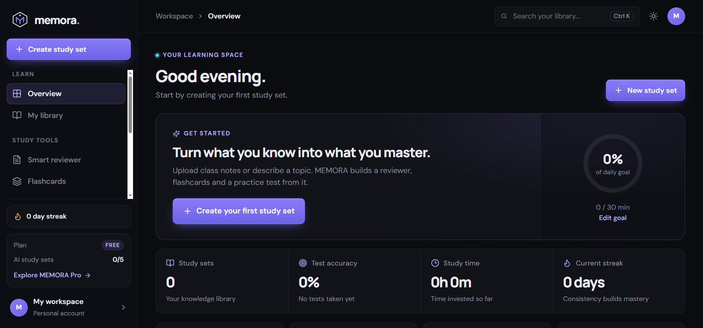
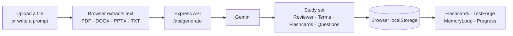

<div align="center">

<!-- ANIMATED HEADER -->


<!-- ANIMATED TYPING -->


<br/>

**An AI-powered learning platform that turns your notes, slides, and documents into reviewers, flashcards, and practice exams, then keeps you on schedule with spaced repetition.**

<br/>

[](https://react.dev)
[](https://www.typescriptlang.org)
[](https://vite.dev)
[](https://expressjs.com)
[](https://www.framer.com/motion/)
[](https://ai.google.dev)
[](https://github.com/rheillunio2-byte/Memora?tab=MIT-1-ov-file)
[](#-known-limitations)

<br/>

[Overview](#-overview) •
[Preview](#-application-preview) •
[Features](#-features) •
[Tech Stack](#-tech-stack) •
[How It Works](#-how-it-works) •
[Getting Started](#-getting-started) •
[Contributing](#-contributing) •
[License](#-license)

</div>

---

## ✦ Overview

**MEMORA** helps students study with intention. Bring a PDF, Word document, slide deck, plain notes, or just a topic, and MEMORA builds a complete study set from it: a structured **reviewer**, key **terms**, **flashcards**, and a **practice exam**.

From there, the platform keeps the learning loop going. Flashcards are scheduled with spaced repetition, exam mistakes are collected in a notebook, and a progress dashboard shows where to focus next.

> **UNDERSTAND. PRACTICE. REMEMBER. MASTER.**

### ✨ Why MEMORA?

- **Source-grounded.** Study material is generated from *your* documents, not generic content.
- **One workspace.** Reviewer, flashcards, tests, review schedule, and analytics live together.
- **Honest data.** Every statistic comes from your real activity. There are no fake numbers or sample users.
- **Private by default.** Your workspace is stored in your own browser, and the AI key stays on the server.

---

## 📸 Application Preview

<div align="center">

### Overview


*A learning command center: your next step, study goal, statistics, upcoming reviews, and recommendations.*

<br/>

### My Library


*Every study set you create, organized in one place.*

<br/>

### Smart Reviewer


*A document-intelligence workspace with collapsible sections, key terms, and a study checklist.*

<br/>

### Mistake Notebook


*Every wrong answer collected with its explanation, ready to turn into a flashcard.*

<br/>

### Progress


*Accuracy trends, topic performance, and examination history.*

<br/>

### Ask MEMORA


*A study companion that answers using the study set you selected.*

</div>

---

## 🚀 Features

### 📊 1. Dashboard
- A personalized greeting and a **"next step"** recommendation based on your real activity.
- Study goal ring, learning statistics, and study streak.
- Upcoming reviews, recent activity, and study recommendations.
- Animated counters, charts, and progress indicators.

### 📚 2. Study Set Generation
- Upload **PDF, DOCX, PPTX, or TXT** files, or write a topic or prompt.
- Choose the number of questions and the difficulty.
- Add custom instructions to focus the output.
- Text is extracted in your browser before it is sent for generation.

### 📝 3. Smart Reviewer
- Generated reviewer with **collapsible sections** and an expand/collapse-all control.
- Key terms with definitions.
- An animated **study checklist** with progress.

### 🃏 4. Flashcard Studio
- **3D flip** animation with keyboard control (`Space`, arrows, `1`–`4`).
- Rate recall as **Again, Hard, Good, or Easy**, and see each choice's next review interval.
- Add your own cards.

### 🎯 5. TestForge
- A focused exam environment with a question navigator and **flag for review**.
- Elapsed-time display and smooth question transitions.
- Animated results with a topic breakdown and a full answer review.

### 🔁 6. MemoryLoop
- Spaced repetition with an **SM-2-inspired** scheduler.
- Cards due today, mature and learning counts, and per-collection review progress.

### 📓 7. Mistake Notebook
- Every missed question with the correct answer and an explanation.
- Convert a mistake into a flashcard in one click.

### 📈 8. Progress Intelligence
- Accuracy trend, exam time per day, topic performance, and exam history.

### 💬 9. Ask MEMORA
- A conversational study companion grounded in your selected study set.

### 🎨 10. Premium Interface
- Dark charcoal interface with violet and indigo accents, plus a light theme.
- Page transitions, a sliding sidebar indicator, micro-interactions, and toasts.
- Responsive layout with a mobile bottom navigation bar.
- Accessible dialogs, keyboard shortcuts, visible focus states, and **reduced-motion support**.

---

## 🧰 Tech Stack

<div align="center">


</div>

| Layer | Technology | Purpose |
|---|---|---|
| **Frontend** | React 18 + TypeScript | UI and type safety |
| | Vite 6 | Dev server and build tooling |
| | Framer Motion 11 | Animations and transitions |
| | Recharts 2 | Charts and data visualization |
| | Lucide React | Icons |
| | Custom CSS design system | Dark/light themes via CSS variables, with no UI framework |
| **Backend** | Node.js + Express 4 | API server |
| | Zod | Request validation |
| | CORS | Cross-origin handling |
| **AI** | Google Gemini API | Study set generation and Ask MEMORA (default model `gemini-2.0-flash`) |
| **Documents** | pdfjs-dist | PDF text extraction |
| | Mammoth | DOCX text extraction |
| | JSZip | PPTX text extraction |
| **Storage** | Browser `localStorage` | Workspace persistence |
| | Supabase / PostgreSQL schema | Optional foundation in `database/schema.sql`, not required to run |
| **Tooling** | tsx, concurrently | Run the server and client together |
| | Vitest | Unit tests |

---

## 🔬 How It Works



### Spaced repetition

MEMORA's scheduler is **SM-2 inspired**:

| Recall | Result |
|---|---|
| **Again / Hard** | The card returns tomorrow and its repetition count resets |
| **First good recall** | Reviewed again in **1 day** |
| **Second good recall** | Reviewed again in **6 days** |
| **After that** | The previous interval is multiplied by the card's **ease factor** (clamped between 1.3 and 2.8) |

The scheduling logic lives in [`src/lib/srs.ts`](src/lib/srs.ts) and is covered by unit tests.

---

## 📦 Getting Started

### Prerequisites

- **Node.js 18+** (20+ recommended)
- A **Google Gemini API key** for AI generation ([get one here](https://aistudio.google.com/app/apikey))

### 1. Clone the repository

```bash
git clone https://github.com/rheillunio2-byte/Memora.git
cd Memora
```

### 2. Install dependencies

```bash
npm install
```

### 3. Configure environment variables

```bash
cp .env.example .env
```

Open `.env` and add your key:

```env
GEMINI_API_KEY=your_key_here
```

### 4. Run the app

```bash
npm run dev
```

| Service | URL |
|---|---|
| Web app | http://localhost:5173 |
| API | http://localhost:8787 |
| Health check | http://localhost:8787/api/health |

The health check reports `aiConfigured: true` once your key is set. Without a key the interface still opens, but AI generation and Ask MEMORA will return an error.

### Available scripts

| Command | Description |
|---|---|
| `npm run dev` | Start the client and server together |
| `npm run dev:client` | Start only the Vite client |
| `npm run dev:server` | Start only the API server |
| `npm run build` | Type-check and build for production |
| `npm run preview` | Preview the production build |
| `npm start` | Run the API server |
| `npm test` | Run the unit tests |

### Environment variables

| Variable | Required | Description |
|---|---|---|
| `GEMINI_API_KEY` | For AI features | Google Gemini API key. **Server-side only. Never prefix it with `VITE_`.** |
| `GEMINI_MODEL` | No | Gemini model name (default `gemini-2.0-flash`) |
| `PORT` | No | API port (default `8787`) |
| `SUPABASE_URL`, `SUPABASE_ANON_KEY`, `SUPABASE_SERVICE_ROLE_KEY` | No | Reserved for the optional Supabase foundation |

---

## ⌨️ Keyboard Shortcuts

| Where | Keys |
|---|---|
| Anywhere | `Ctrl/Cmd + K` focuses search |
| Flashcards | `Space` flip · `←` `→` navigate · `1`–`4` rate after flipping |
| TestForge | `A`–`D` or `1`–`4` choose an answer · `←` `→` navigate |
| Dialogs | `Esc` closes · `Tab` stays inside the dialog |

---

## 📂 Project Structure

```text
Memora/
│
├── src/
│   ├── App.tsx              # State, handlers, and page routing
│   ├── main.tsx             # Entry point (reduced-motion aware)
│   ├── styles.css           # Design tokens and component styles
│   ├── types.ts
│   ├── components/          # UI primitives, shell, modals, charts
│   ├── pages/               # Dashboard, Library, Reviewer, Flashcards,
│   │                        # TestForge, MemoryLoop, Mistakes, Insights,
│   │                        # Ask, Settings
│   ├── lib/                 # motion variants, SM-2 scheduler, formatting, storage
│   └── services/            # document extraction and AI requests
│
├── server/
│   └── index.ts             # Express API (Gemini proxy)
│
├── database/
│   └── schema.sql           # Optional Supabase / PostgreSQL foundation
│
├── tests/                   # Vitest unit tests
├── public/                  # Logo and static assets
├── images/                  # README screenshots
│
├── README.md
├── CONTRIBUTING.md
├── LICENSE
└── .env.example
```

---

## 🔒 Privacy and Security

- Your Gemini API key stays on the **server** and is never exposed to the browser.
- Study sets, results, and settings are stored in **your browser** (`localStorage`).
- When you generate a study set or ask a question, the relevant source text is sent to the Gemini API through the MEMORA server.
- Never commit your `.env` file.

---

## ⚠️ Known Limitations

MEMORA is a prototype. Please be aware of the current limits:

- **No accounts or cloud sync.** Data lives in one browser, and clearing site data removes it.
- **AI output can be wrong.** Verify important information against your original materials.
- **Study streak** is displayed but is not updated yet.
- **Daily goal** counts cumulative study minutes rather than resetting each day.
- **MemoryLoop** opens the full deck of a collection, not only the due cards.
- **MEMORA Pro** is a preview. No payments or limits are enforced.
- The **Supabase schema** is a foundation and is not connected to the app.

---

## 🗺️ Future Improvements

- [ ] Track the daily study streak automatically.
- [ ] Review only the cards that are due.
- [ ] Reset the daily goal each day.
- [ ] User accounts and cloud sync with Supabase.
- [ ] Study set import and export.
- [ ] Additional exam modes, including timed exams.
- [ ] More languages and expanded accessibility testing.

These are possibilities, not features of the current version.

---

## 🤝 Contributing

Contributions are welcome. Please read [CONTRIBUTING.md](CONTRIBUTING.md) first.

1. Fork the repository.
2. Create a branch.
3. Make and test your changes.
4. Open a pull request.

---

## 📄 License

MEMORA is distributed under the **MIT License**.

See the [LICENSE](https://github.com/rheillunio2-byte/Memora?tab=MIT-1-ov-file) file for more information.

---

## 👨‍💻 Developer

<div align="center">

[](https://github.com/rheillunio2-byte)

[Visit the Repository](https://github.com/rheillunio2-byte/Memora)

</div>

---

<div align="center">


**UNDERSTAND • PRACTICE • REMEMBER • MASTER**

⭐ If MEMORA helps you study, consider giving the repository a star!

</div>
